<h3>jean@github ~ $ neofetch</h3>

<table>
  <tr>
    <td valign="top"></td>
    <td valign="top"></td>
  </tr>
</table>

 

<h3>jean@github ~ $ cat about.txt</h3>

I'm Jean Pereira. I work in IT and spend my free time taking programs and games apart: 
reverse engineering, rebuilding them natively, and writing tools for their formats. 
I also do 3D modeling and rigging. Away from the screen I play guitar and listen to rock, metal and MPB.

 

<h3>jean@github ~ $ ls ~/projects</h3>

**PS2 and console reverse engineering**

| Project | What it is |
| --- | --- |
| [CrystalOSD](https://github.com/JeanxPereira/CrystalOSD) | The PS2 OSDSYS (Crystal Clock, menus, opening, Browser) reimplemented natively in C++26 and Vulkan, bit-faithful to the console |
| [Watson](https://github.com/JeanxPereira/Watson) | PCSX2 instrumented with an MCP server: EE/IOP probes, GIF/GS and SPU2 traces, frame-exact captures |
| [GoWToolkit](https://github.com/JeanxPereira/GoWToolkit) | Cross-platform toolkit for browsing, inspecting and extracting God of War game assets |
| [OnyxSDK](https://github.com/JeanxPereira/OnyxSDK) | A reusable game-asset-explorer SDK |
| [Icon-Composer](https://github.com/JeanxPereira/Icon-Composer) | Apple's Icon Composer decoded and reimplemented: the `.icon` format read from the binary that writes it |

**[Resurrection Capsule](https://github.com/JeanxPereira/resurrection-capsule): a local server for Darkspore**

| Project | What it is |
| --- | --- |
| [ReCap.Server](https://github.com/JeanxPereira/recap_server) | Server application for Darkspore ReCap |
| [ReCap.WebKit](https://github.com/JeanxPereira/ReCap.WebKit) | A modern replacement for Darkspore's `EAWebkit.dll` |
| [RakNexus](https://github.com/JeanxPereira/RakNexus) | C# port of RakNet 3.92 for ReCap |
| [AssetData.Parser](https://github.com/JeanxPereira/ReCap.Parser) | Binary parser for Darkspore asset files |
| [DBPF.Unpacker](https://github.com/JeanxPereira/recap_unpacker) | Unpacker for Darkspore `.package` files |
| [ReCap.Luptos](https://github.com/JeanxPereira/ReCap.Luptos) | Lua decompiler for Darkspore scripts |
| [BMDL Importer](https://github.com/JeanxPereira/BMDL-Importer) | Blender 4.5 importer for Darkspore `.bmdl` meshes, bones and animations |

**Other**

| Project | What it is |
| --- | --- |
| [build.prop syntax](https://github.com/JeanxPereira/vscode-buildprop-syntax) | VS Code syntax support for Android `build.prop` files |
| [Sonner-JS](https://github.com/JeanxPereira/sonner-js) | A port of the Sonner toast component to vanilla JavaScript |
| [CMI-Sprites](https://github.com/JeanxPereira/CMI-Sprites) | Every sprite extracted from The Curse of Monkey Island |
| [AQS-Sprites](https://github.com/JeanxPereira/AQS-Sprites) | Every sprite extracted from The Ancient Quest of Saqqarah |

 

<h3>jean@github ~ $ git log --since="1 year ago"</h3>

  

